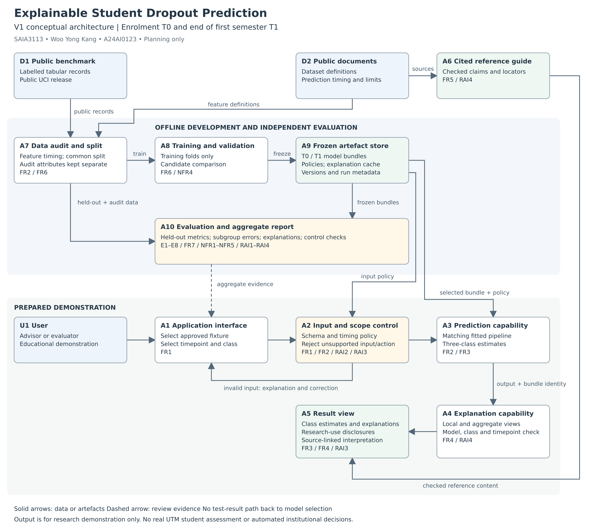

# V1 Architecture Decisions and Traceability

**Project:** Explainable Student Dropout Prediction Using Early Academic Indicators\
**Course:** SAIA3113 AI Engineering | Topic 2 Lab Part C\
**Student:** Woo Yong Kang | A24AI0123\
**Version:** 1.0 | 5 November 2026\
**Status:** Conceptual architecture. Components describe planned capabilities, not implemented services.

This design follows the [requirements](week2_requirements.md) and [evaluation criteria](week2_evaluation_criteria.md). Start with user → interface → prediction capability → output. Add feature validation, a source-linked guide, explanations and a separate evaluation path because the requirements justify them. The diagram labels functions rather than committing to a UI framework, model product or deployment platform.

## V1 conceptual architecture

[Editable Draw.io source](week2_architecture_v1.drawio)

The diagram has two paths: the prepared demonstration and offline model development/evaluation. Solid arrows carry data or artefacts. Dashed arrows show evidence used for review; they do not feed test results back into model selection.

## Architecture needs derived from requirements

| Requirement IDs | What the requirement needs | Architecture response |
| --- | --- | --- |
| FR1 / FR2 / RAI2 | Approved inputs and a known information cutoff. | A1 interface and A2 input/scope control; versioned feature policy from A7. |
| FR2 / FR3 / FR6 | Matching preprocessing, model and class order for each timepoint. | A3 prediction capability loads a frozen T0 or T1 bundle from A9. |
| FR4 / RAI4 | Explanations tied to the selected input, class, model and timepoint. | A4 explanation capability uses the selected bundle and a versioned explanation cache. |
| FR5 / RAI4 | Verifiable definitions and interpretation limits. | A6 reference guide containing manually checked claims from D2 approved public documents. |
| FR3 / RAI3 | Outputs that cannot be mistaken for decisions or causal findings. | A5 result view includes mandatory disclosures and exposes no institutional decision action. |
| FR6 / NFR4 | Consistent data splits and training-only selection. | A7 audit/split preparation and A8 training/validation; A9 freezes the resulting artefacts and metadata. |
| FR7 / NFR1 / NFR2 / RAI1 | Independent evidence about quality and group errors. | A10 evaluation/reporting receives frozen artefacts and the separate held-out partition. |
| NFR3 / NFR5 | A short, inexpensive interaction path. | Reuse loaded bundles and precompute explanation fixtures; no external model service is required. |

## Component responsibilities and flows

| ID | Component | Responsibility |
| --- | --- | --- |
| U1 | User | Advisor viewing the demonstration or evaluator inspecting results. |
| A1 | Application interface | Selects an approved fixture, T0/T1 and explanation class. Offers the reference guide and aggregate report. |
| A2 | Input and scope control | Checks schema, range, provenance, forbidden fields and timepoint policy; rejects unsupported operations. Invalid input returns a validation message without invoking the predictor. |
| A3 | Prediction capability | Applies the selected fitted preprocessing and returns the three-class estimates and predicted label. |
| A4 | Explanation capability | Returns matching local contributions and aggregate summaries; verifies cached identity and output scale. |
| A5 | Result view | Combines predictions, explanations, version information and research-use disclosures. |
| A6 | Cited reference guide | Provides a compact set of checked statements and source locators. It does not generate unrestricted answers. |
| A7 | Data audit and split preparation | Reads the public dataset, checks provenance and duplicates, documents feature availability, and creates the common split. Audit-only attributes are kept separate from predictors. |
| A8 | Training and validation | Fits candidate pipelines on training folds and selects configurations by validation evidence only. |
| A9 | Frozen artefact store | Holds timepoint-specific preprocessing/models, feature policies, explanation configuration/cache and run metadata. A versioned local directory is sufficient. |
| A10 | Evaluation and report | Evaluates frozen artefacts on held-out records, checks controls and explanations, and reports metrics, gaps, latency and failed/inconclusive targets. |
| D1 | Public benchmark | Labelled tabular records used for retrospective development and evaluation. |
| D2 | Public source documents | Dataset definitions and research context supporting the guide and feature policy. These are not additional labelled training records. |

The developer runs D1 → A7 → A8 → A9 offline. A7 also sends the untouched held-out partition and audit attributes directly to A10. A10 loads A9 only after model selection is frozen. Test outcomes cannot flow into A8 for tuning. The report is available to the evaluator through A1; it does not automatically retrain a model or trigger a student action.

For the prepared demonstration, U1 → A1 → A2 → A3 → A4 → A5. A9 supplies the selected artefacts. A6 supplies verified reference content. Explanation fixtures are precomputed after model freezing, with training-only background data; model versions and input fingerprints prevent mismatched cache reuse. No paid API, vector database, agent memory or orchestration platform is justified by V1 requirements.

## Architecture decision records

| ID and decision | Requirement / constraint | Alternatives considered | Selected option | Trade-off accepted |
| --- | --- | --- | --- | --- |
| ADR1 Separate timepoint bundles | O1; FR2; E1; feature availability. | One model using every feature; one model with unavailable fields blanked; separate T0/T1 bundles. | Separate feature policies and fitted bundles for T0 and T1. | More artefacts to manage, but the input cutoff and comparison are explicit. Earlier predictions may be less accurate. |
| ADR2 Separate training and held-out evaluation | FR6; NFR1; NFR4; E2/E8. | Select from test results; use training-only cross-validation and a final holdout. | Training-only selection with one locked common holdout and a majority baseline. | Fewer records for fitting and a noisier final estimate, but test evidence remains independent of selection. |
| ADR3 Use a static cited guide | FR5; RAI4; NFR5; E4/E7. | Unrestricted chatbot; retrieval-augmented generation; manually checked reference entries. | A small source-linked guide covering the defined domain. | Less conversational flexibility and manual update work, but its claims are inspectable and it needs no model API. |
| ADR4 Prepare explanations for a bounded demo | FR1/FR4; NFR3; RAI4; E4/E7. | Recompute all explanations per interaction; precompute versioned approved fixtures. | Precompute explanations for the permitted fixture set, keyed to exact model, timepoint, input, class and explainer settings. | Extra preparation and cache management; arbitrary new records are outside the interactive scope. The full prepared result can respond promptly. |
| ADR5 Keep audit attributes separate | FR2; RAI1; RAI2; E5/E6. | Ignore group attributes entirely; use all attributes as predictors; retain separate audit metadata. | Exclude gender/nationality from V1 predictors but retain them securely for aggregate auditing; examine age groups as specified. | Exclusion may affect accuracy and does not remove proxy bias. Keeping audit metadata requires publication controls. |
| ADR6 Enforce research-only interaction | FR1/FR3; RAI2/RAI3; E6. | Open real-record uploads and decision actions; warnings alone; approved fixtures with application-level operation checks. | Approved fixture selection, input/operation validation and compulsory result disclosures. | Reduced realism and no live institutional use, but the demonstration cannot legitimately be presented as a student decision system. |

These decisions refine Week 1 without changing the target, objectives or candidate model comparison. Specific software choices can be refined later if they continue to satisfy the requirements.

## Initial requirements traceability matrix

| Objective | Requirement IDs | Evaluation criterion | Architecture element | Later evidence |
| --- | --- | --- | --- | --- |
| O1 | FR1 / FR2 | E1 input and timing controls | A2 input control; A7 feature audit; A9 policies | Column-level availability table, valid/invalid fixture log and split/fit audit. |
| O3 | FR6 / FR7 / NFR1 | E2 class-balanced performance | A8 training; A10 independent evaluation | Frozen selection record, baseline comparison and macro-F1 results. |
| O3 | FR7 / NFR2 | E3 dropout errors | A10 evaluation/reporting | Dropout precision/recall, class counts, intervals and confusion matrices. |
| O2 | FR4 / RAI4 | E4 explanation fidelity | A4 explanations; A9 versioned cache | Identity checks, contribution comparisons and reconstruction residuals. |
| O2 | FR5 / RAI4 | E4 source support | A6 guide; D2 source documents | Complete claim-to-source ledger with page/section checks. |
| O3 | FR7 / RAI1 | E5 subgroup disparities | A7 separate audit attributes; A10 reporting | Group denominators, error rates, intervals and pass/fail/inconclusive decisions. |
| O1 / O2 | FR1 / FR3 / FR7 / RAI2 / RAI3 | E6 privacy and scope | A2 controls; A5 disclosures; A10 publication review | Prohibited-input/action logs, network inspection and output-file review. |
| O2 | FR3 / FR4 / NFR3 / NFR5 | E7 latency and cost | A3 prediction; A4 cached explanations; A9 local artefacts | Per-timepoint timing distributions, cold-start/preparation timings and API-call count. |
| O2 / O3 | FR6 / FR7 / NFR4 | E8 reproducibility | A7 common split; A8 fixed configuration; A9 metadata | Repeated-run comparison, dependency record, seeds and data/model checksums. |

The Later Evidence column names future outputs, not files already produced or tests already passed.

## V1 design review

- Every major component has a requirement link in the architecture-needs table.
- The diagram includes benchmark data, public source documents, feature control, explanations and evaluation.
- Held-out data bypasses training; audit attributes remain separate from predictors.
- Model quality and latency constrain existing components rather than requiring artificial quality or latency services.
- The reference guide is deliberately small, and the demonstration accepts only approved fixtures.
- Model names remain in the experiment plan, while diagram boxes describe capabilities.
- Functional safety checks and disclosures do not prove fairness, causal validity or readiness for deployment.

## Part C reflection

ADR1 involves the most important trade-off. FR2 requires each prediction to use information available at its stated timepoint, so I chose separate T0 and T1 feature policies and model bundles. Using all available columns would be easier and might produce a stronger headline score, but it would not answer the early-prediction question. I accept additional version management and potentially weaker enrolment-time performance so that the comparison remains meaningful. The held-out comparison will show whether the added first-semester information justifies the later prediction point.
