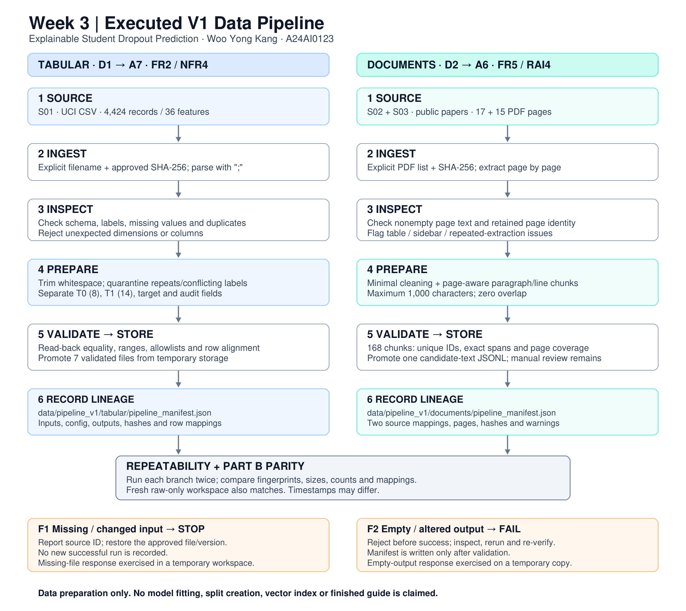

# Week 3 V1 Pipeline Decisions and Traceability

**Project:** Explainable Student Dropout Prediction Using Early Academic Indicators  
**Student:** Woo Yong Kang | A24AI0123  
**Course:** SAIA3113 AI Engineering | Topic 3 Lab, Part C  
**Version:** week3-v1 | 12 November 2026

The executed pipeline prepares two independent data branches from the raw project sources. It implements the preparation part of D1 → A7 and the source preparation needed by D2 → A6 in the [Week 2 architecture](week2_architecture_v1.png). It does not implement A7's eventual split, A8 training, model freezing, embeddings or the finished reference guide.

## C1. Executable implementation and evidence

The full [notebook](../notebooks/week3_pipeline.ipynb) includes Parts A–C and the complete reusable functions from [src/week3_pipeline.py](../src/week3_pipeline.py). `run_pipeline(kind, base_dir, registry, configuration, runtime)` reads raw files on each call; it never reads Part B's prepared dataframe, chunk list or exported data.

| Branch | Inputs | Executed preparation | Output directory | Observed result |
|---|---|---|---|---|
| Tabular / Pathway B | S01 UCI `uci_dropout.csv` | Semicolon parsing, schema checks, whitespace trimming, duplicate/conflict quarantine, predictor/label/audit separation | `data/pipeline_v1/tabular/` | 4,424 retained rows; 0 quarantined rows; 8 T0 and 14 T1 predictors; 7 output files |
| Documents / Pathway A | S02 `realinho_2022.pdf`; S03 `martins_2023.pdf` | Page extraction, minimal cleaning, page-aware paragraph/line packing; 1,000-character cap; no overlap | `data/pipeline_v1/documents/` | 108 + 60 = 168 chunks across 17 + 15 = 32 pages; one combined JSONL |

Each branch writes its own `pipeline_manifest.json`. The common Part B `data/week3_manifest.json` remains separate. The tabular allowlist retains its Part B policy identifier `week3-ab-v1`; the executing pipeline is `week3-v1`. The policy has not changed merely because execution was integrated.

### Actual verification

- Both branches passed two-run comparison of input/output SHA-256 values, byte sizes, output counts, configuration, inspection results, warnings and source-to-output mappings. Only the execution timestamp is excluded from comparison.
- All **8 prepared output files** match the corresponding Part B files byte for byte.
- Both branches passed a fresh-workspace check containing only the three raw inputs, proving independence from Part B's prepared files and in-memory results.
- F1 missing input and F2 empty output were deliberately exercised on temporary copies; both were rejected. Actual source and successful output files were unchanged.
- All **16 notebook code cells** completed. Part A/B retained its 37 passing content/provenance checks.

Evidence: [first run](../evidence/week3_run1.json), [second run](../evidence/week3_run2.json), [repeatability and Part B parity](../evidence/week3_repeatability.json), and [independence/failure checks](../evidence/week3_independence_and_failures.json). The actual runtime is recorded in [environment.json](../evidence/environment.json). The supplied execution is local Python, not Google Colab; it does not constitute Colab platform evidence. These checks demonstrate same-environment preparation repeatability, not the Week 2 NFR4 model-evaluation acceptance target or cross-environment reproducibility.

## C2. Executed workflow

[Editable Draw.io source](week3_pipeline_diagram.drawio). The PNG and editable source were generated from the same node/edge specification. Numbered stages show dependencies, and the two failure callouts describe the tested responses. The document and table branches are separate; no generic text chunking is applied to table rows.

## C3. Requirement traceability

| Requirement / evaluation link | Data need | Pipeline response | Evidence / limit |
|---|---|---|---|
| FR2 / E1; ADR1 | Enrolment and first-semester feature windows | Exact T0/T1 lists, forbidden-column guard, same internal row keys | Feature-policy CSV, allowlist JSON and read-back checks; precise real-time availability is not proven for every raw field |
| FR5 / RAI4 / E4; ADR3 | Verifiable reference content | Every chunk retains source URL/hash/version, PDF page and cleaned-page offsets | JSONL records and two document lineage mappings; every final guide claim still needs manual source checking |
| NFR4 / E8; ADR2 | Repeatable preparation and provenance | Fixed input hashes, explicit parameters and dependencies; two runs plus fresh-workspace verification | Equal fingerprints/mappings; no model, split or predictive metric has been evaluated |
| RAI1 / E5; ADR5 | Later subgroup auditing without demographic predictors | Gender/nationality in separate audit table; age follows the existing dual-use policy | Audit/label rows align with predictor rows; exclusion does not prove fairness |
| RAI2 / E6 | Controlled publication | Publish aggregate notebook output and provenance, retain row-level tables in private working files | `.gitignore` patterns and storage note; no real UTM data or record linkage |

### Decisions and accepted trade-offs

| Decision | Part B evidence / alternatives | Selected configuration and reason | Accepted limitation |
|---|---|---|---|
| C-ADR1 Preserve the table meaning | 4,424 rows before and after; no missing cells or duplicates; one trailing-tab header | Trim surrounding header/text whitespace; quarantine conflicts and repeated exact rows; retain other values | This release does not exercise nonzero duplicate removal. Numeric category codes are not model-ready encodings |
| C-ADR2 Reuse conservative feature policy | Eight T0 fields plus six semester-one fields; target, audit and excluded-timing roles already documented | Reuse the Part B lists exactly and validate row alignment; no fitted preprocessing | Potentially useful socioeconomic fields remain unselected; later expansion requires justified policy revision |
| C-ADR3 Preserve page provenance | S02: 96 fixed chunks versus 108 selected, cross-page chunks 16 → 0; S03: 51 versus 60, cross-page chunks 14 → 0 | Page-aware paragraph/line packing, max 1,000 characters, overlap 0, minimal-clean-v1 | Page breaks can interrupt an argument; line breaks are not semantic boundaries. Table extraction remains imperfect |
| C-ADR4 Raw landing with staged preparation | Raw originals must remain inspectable and reprocessable | Retain raw files first; extract/transform into temporary files, validate, then store prepared files and lineage | Extra storage and a temporary working directory; no distributed transaction guarantees |
| C-ADR5 Batch execution | Three static, versioned sources; no latency or live-update requirement | Manually triggered batch runs, one branch at a time, no scheduler/orchestrator | New releases require reviewed source hashes/configuration and a rerun; no streaming freshness guarantee |
| C-ADR6 Fail before recording success | A nonempty file alone can contain the wrong data | Read-back/content checks, fingerprints and source/output mapping validation; write the new run manifest last | A process interruption during multi-file promotion is not fully atomic; rerun and verify before using outputs |
| C-ADR7 Separate execution and preparation manifests | Part B describes preparation; Part C must describe an actual run | Keep `data/week3_manifest.json` and per-branch `pipeline_manifest.json` | Several metadata files to maintain, but their roles are explicit |

### ETL versus ELT

The complete workflow starts with raw files already landed in local storage, followed by staged transformations. It therefore follows the lecture's **raw landing + staged transformations** pattern, with an **ETL-style preparation subflow**: extract/inspect, transform, then load validated prepared outputs. It is not a claim that all transformation occurs inside an analytical warehouse. Both raw and prepared versions are retained for reprocessing.

### Stage contracts and failure responses

| Stage | Input / operation | Output / evidence | Failure response |
|---|---|---|---|
| Ingest | Exact filenames, selected source IDs, approved hashes and attributed sources | Present files with matching source SHA-256 and recorded bytes | **F1:** missing file or changed checksum → stop and name the source; restore or review the new version |
| Inspect | Parse CSV with `;`, check shape/columns/labels; extract each PDF page | Actual row/schema/class aggregates or nonempty page text, plus extraction warnings | Wrong structure/empty page → stop; report OCR/layout needs rather than generate empty chunks |
| Prepare | Apply the recorded Part B configuration | Temporary tabular views or page-linked chunks | No remaining data, forbidden predictor, invalid chunk size or failed transformation → raise an error |
| Validate | Reopen exports; compare values, column order, row mapping, chunk coverage and hashes | Read-back equality and nonempty output files; header-only quarantine log allowed when count is zero | **F2:** absent, empty, changed or incorrect output → fail; no new successful manifest |
| Store | Promote only validated files to the selected branch directory | Eight final prepared files across both branches | Filesystem error → fail; rerun and re-verify after recovery |
| Record lineage | Map every selected source to the exact output, with config/environment and warnings | Per-branch JSON run manifest, written last and read back | Missing source/output mapping or hash mismatch → fail and investigate |
| Rerun | Re-execute from raw files with the same configuration | Equal deterministic signatures and Part B output hashes | Any mismatch → report failure; do not discard an unexplained difference |

A previous manifest can remain after a failed new attempt; its timestamp describes the earlier successful run. It must not be presented as evidence that the failed attempt succeeded.

## Provenance, access and quality caveats

The [source registry](../data/source_registry.json) carries author attribution, CC BY 4.0 rights, canonical links, versions and acquisition dates. S01 is the 4,424-row UCI release. S03 describes 4,433 study records in section 4.1 (PDF page 4); the two versions are not silently equated. S02 and S03 provide interpretation context, not extra labelled training rows.

The S02 PDF contains repeated/overlapping table extraction and peer-review text. Both PDFs include first-page sidebar material and possible table reading-order loss. The pipeline retains original bytes and marks every chunk for manual review. It does not claim that page locators or checksums alone establish semantic correctness.

Source snapshots and annual macroeconomic release times remain uncertain for some fields. Those fields stay outside the conservative predictor lists. No imputation, scaling, balancing, split, model fitting or held-out optimisation is performed. The data concerns Portuguese higher education and does not establish UTM performance.

## C4. Saved artefacts and repository record

The private `Lab3_ABC_WOO_YONG_KANG_A24AI0123.zip` contains the notebook, raw inputs, Part B outputs, Part C outputs, both kinds of manifests, documentation, diagrams and execution evidence. Relative paths match the existing repository structure. The local/Colab working location is `data/` under the project root (`/content/week3_project/data/` in Colab); Colab storage is temporary and outputs must be downloaded before reset.

The original Week 2 RAI2 rule restricts publishing real row-level profiles even though the UCI source permits attributed reuse. Therefore public GitHub receives the code, diagrams, documentation, aggregate evidence, source registry, manifests and attributed document text, while row-level CSVs stay in the private submission/working package. `data/WEEK3_STORAGE.md` records how to recreate them from the pinned public source. `.gitignore` is a convenience guard, not a mechanism for removing previously tracked data.

Repository: https://github.com/ykwooga-afk/ai-engineering-labs. The README is updated with Week 3 links and actual verification status. Repository upload and a local passing run do not replace any required Colab execution or course-portal submission.

## Part C reflection

The main engineering change is that preparation now starts from named raw sources and produces checked outputs without relying on earlier exploratory variables. Keeping the Part B configuration fixed lets the byte-for-byte comparison show whether integration changed the result. Separate source/output mappings also make the two-document JSONL traceable. The remaining PDF reading-order problems are visible in the warnings; rerunning the same extraction reproduces those limitations rather than proving that they have been solved.
